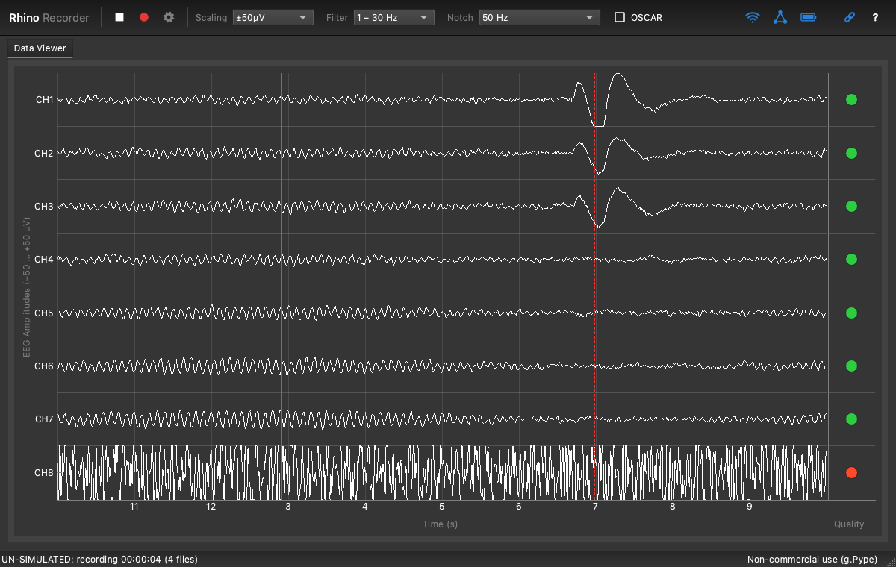

# Rhino Recorder


Acquire, view, record and stream EEG from the g.tec **Unicorn Hybrid
Black** on Windows, macOS and Linux. Rhino Recorder works like g.tec's
[Unicorn Recorder](https://github.com/unicorn-bi/Unicorn-Recorder-Hybrid-Black),
but runs on [g.Pype](https://gpype.gtec.at) with the licence-free
[gpype-rhino](https://github.com/itubrainlab/gpype-rhino) Bluetooth
driver instead of g.tec's Windows-only Unicorn driver, and wears g.Pype's
own dark theme.



## What it does

As in Unicorn Recorder:

- Play/stop acquisition, record (which starts acquisition if needed),
  settings, user manual.
- Status icons for wireless data loss, network interfaces and battery,
  and a disconnect button.
- A 10-second sweeping data viewer for the eight EEG channels, with
  amplitude **Scaling**, the same predefined **Filter** (bandpass,
  highpass, lowpass) and **Notch** (50/60 Hz, cascading) choices, and
  **OSCAR** artifact removal.
- A trigger row with each trigger's value, and a tick across all channels,
  coloured by trigger value.
- Signal quality for each electrode, shown beside its channel's trace.
- The same 19 channels in the same order (EEG 1–8, ACC, GYR, CNT, BAT,
  VALID, DT, TRIG), each optional block switchable in the acquisition
  settings.
- Four loggers: raw and processed, each as CSV and as BDF+, each with its
  own folder and prefix, files named `<prefix>_<YYYYMMDD>_<HHMMSS>`.
- Trigger UDP input into the TRIG channel; raw and processed outputs
  over UDP and LSL.
- Device information.

Python equivalents of Unicorn Recorder's examples are in
[examples/](examples): a UDP trigger sender, a UDP receiver, an LSL
receiver, and a file reader in place of the MATLAB import script.

### Differences from Unicorn Recorder

| | Unicorn Recorder | Rhino Recorder |
|---|---|---|
| Platforms | Windows | Windows, macOS, Linux |
| Driver | g.tec Unicorn driver | gpype-rhino (Bluetooth serial) |
| Test signal input, digital outputs, firmware version | yes | no: gpype-rhino does not implement these commands |
| OSCAR | processed outputs only | all outputs, raw ones included (g.Pype runs OSCAR at the source); switching it restarts acquisition |
| Default ports | trigger 1000, UDP outputs 1001 and 1002 | trigger 10000, UDP outputs 10001 and 10002: no administrator rights needed on any platform |
| File and stream names | `UnicornRecorder…` | `RhinoRecorder…` (configurable) |
| CSV | values only | a header row with the channel names |
| Look | Unicorn branding, light work area | g.Pype's dark theme; a rhino pretending to be a unicorn as its icon |
| Without a headset | none | a simulated headset (`--simulate`) |

## Install

Rhino Recorder needs Python 3.10 or later and git. Python 3.12 is the
safest choice: on Windows, pyedflib (for BDF files) has no prebuilt wheel
for Python 3.13 and later.

```bash
python -m venv .venv
```

Activate it (`.venv\Scripts\activate` on Windows,
`source .venv/bin/activate` elsewhere), then:

```bash
pip install "rhinorecorder @ git+https://github.com/itubrainlab/rhinorecorder"
```

or, to work on it, from a clone of
[itubrainlab/rhinorecorder](https://github.com/itubrainlab/rhinorecorder):

```bash
pip install -e ".[test]"
```

This also installs g.Pype (with its GUI, LSL and file-format extras) from
PyPI and gpype-rhino from GitHub.

### Platform notes

- **Windows**: pair the headset in Bluetooth settings; it appears as a
  COM port.
- **macOS**: pair the headset in Bluetooth settings. gpype-rhino builds
  its RhinoConnect helper on first use, which needs the Xcode command
  line tools (`xcode-select --install`). macOS asks once for Bluetooth
  access.
- **Linux**: pair the headset, then bind it to a serial port and enter
  that port when opening the device:

  ```bash
  sudo rfcomm bind 0 <headset-address>
  ```

  You may need to add yourself to the `dialout` group. Qt needs the usual
  X11/Wayland libraries (on Debian/Ubuntu, `libxcb-cursor0` among them).

## macOS app

`packaging/macos/build_app.sh` builds **Rhino Recorder.app** and a DMG in
`dist/`:

```bash
packaging/macos/build_app.sh
```

It needs the Xcode command line tools, uv, git and this project's
`.venv`. The app contains its own Python, Rhino Recorder, gpype-rhino and
a prebuilt RhinoConnect helper, so its users need neither Python nor
Xcode. It does **not** contain g.Pype: the GNCL forbids redistributing
g.Pype as a standalone executable or bundled artefact. Instead, the first
launch installs g.Pype and the other libraries from PyPI, at the versions
the tests ran with, into `~/Library/Application Support/RhinoRecorder`.
That needs an internet connection and takes a few minutes; later
launches start directly, and an updated app sets itself up again once.

The app is built for the architecture of the Python it bundles (Apple
Silicon here; build on an Intel Mac, or set `PYTHON_HOME` to an x86_64
CPython 3.12, for Intel). It is signed ad hoc only: on another Mac,
open it the first time with right-click → Open, or sign and notarize it
with a Developer ID to avoid the Gatekeeper warning.

## Linux package

`packaging/linux/build_linux.sh` builds
`dist/RhinoRecorder-<version>-linux-x86_64.tar.gz` (it runs on macOS or
Linux):

```bash
packaging/linux/build_linux.sh
```

Like the macOS app, it contains its own Python, Rhino Recorder and
gpype-rhino but not g.Pype, which the first launch installs from PyPI at
the tested versions, into `~/.local/share/RhinoRecorder`. Users unpack
it and run `./install.sh`: no administrator rights, a menu entry with
the icon, and a `rhino-recorder` command; `./uninstall.sh` removes it.
Its [README](packaging/linux/README.txt) covers rfcomm and the dialout
group.

It is for x86_64 only, with glibc 2.34 or newer (Ubuntu 22.04, Debian 12,
Fedora 35 or later): g.Pype publishes no ARM Linux build, and PySide6's
Linux wheels need glibc 2.34.

## Run

```bash
rhino-recorder
```

That opens the device list. To skip it:

```bash
rhino-recorder --device UN-2024.08.41
```

```bash
rhino-recorder --simulate
```

The full user manual is in the app (the **?** button) and in
[src/rhinorecorder/MANUAL.md](src/rhinorecorder/MANUAL.md).

## Licence

Rhino Recorder is MIT licensed; see [LICENSE](LICENSE).

It runs on g.Pype, which is under the **g.tec Non-Commercial License
(GNCL)**: free for private and educational use (academic research,
teaching) together with a g.tec amplifier, which the Unicorn Hybrid Black
is. Read the GNCL before you use Rhino Recorder. In particular:

- Commercial use needs a commercial g.Pype licence from g.tec.
- The GNCL forbids redistributing g.Pype as a standalone executable or
  other bundled artefact, and g.Pype refuses to run a frozen (e.g.
  PyInstaller) application without an attested g.tec device. So Rhino
  Recorder is distributed as a Python package that installs g.Pype from
  PyPI, not as an executable bundle.
- Without a g.Pype licence, g.Pype marks its own output as
  non-commercial. Rhino Recorder writes its files and streams with its
  own nodes, which carry no such mark; the status bar shows when g.Pype
  runs unlicensed. That does not change what the GNCL allows.

## How it works

```text
RhinoHybridBlack ─┐                          ┌─ status tap (battery, data loss, signal quality)
UDPReceiver ──────┴─ Router ─ UnicornLayout ─┼─ Router (selected channels) ─ raw CSV / BDF / UDP / LSL
                                             └─ Filter ─ Notch ─┬─ scope tap
                                                                └─ Router ─ processed CSV / BDF / UDP / LSL
```

- `recorder.py` builds and runs the g.Pype pipeline, with no UI code, so
  it can be scripted and tested.
- `nodes.py` holds Rhino Recorder's own g.Pype nodes: the Unicorn channel
  layout, filters that can be swapped while running, loggers that start
  and stop at a shared sample while acquisition runs, the UDP text
  output, and buffers for the display.
- `simulator.py` simulates the headset at the byte level, so the
  simulated device runs the real gpype-rhino decoder.
- `ui/` is the PySide6/pyqtgraph interface.

## Tests

The tests need no headset: they run against the simulated one, through
the real driver, pipeline, files and sockets.

```bash
pytest
```
