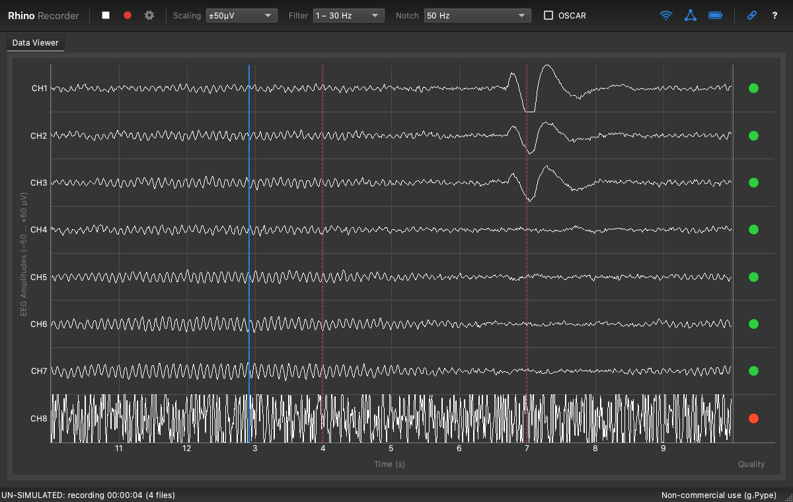

Rhino Recorder acquires, views, records and streams EEG from the g.tec **Unicorn Hybrid Black**, like g.tec's Unicorn Recorder, on Windows, macOS and Linux. It runs on [g.Pype](https://gpype.gtec.at) with g.tec's native [gtec-unicorn](https://pypi.org/project/gtec-unicorn/) driver.

## What's changed in 0.3.0

### g.tec's native driver, with no licence needed
Rhino Recorder now talks to the headset through **gtec-unicorn 2.0.0**, g.tec's own Unicorn driver, used through g.Pype's `HybridBlack` source. It replaces the gpype-rhino Bluetooth driver that 0.1 and 0.2 carried.

- **No licence needed.** gtec-unicorn 2.0.0 is on PyPI and needs no licence key, activation or Unicorn Suite. The first launch installs it from PyPI along with g.Pype.
- **The same driver on every platform:** Windows x64, macOS 14 or later on Apple Silicon, and Linux x86_64.
- **Headsets listed by serial**, for example `UN-2024.08.41`. On macOS and Linux the device dialog finds the headsets in range with a Bluetooth search of a few seconds, and **Search again** repeats it. On Windows it lists the paired headsets. There are no COM ports, `rfcomm` or Bluetooth addresses to set any more.
- **Test signal:** Settings → Acquisition → Input source → Test signal swaps the electrodes for the headset's internal test signal. It is a 7.5 mV peak-to-peak square wave at 1.95 Hz, the same on all eight channels, and the simulated headset now produces the same wave.
- **Firmware and device version** under Settings → Device, read from the headset.
- **Lost samples** are counted from the headset's validation channel.
- **Triggers still line up with the EEG.** Rhino Recorder stamps each sample with when it was acquired (arrival time, less the scans still waiting in the driver, less the link's delay of 40 ms by default) instead of g.Pype's arrival time.

Tested on a Unicorn Hybrid Black on macOS: a 96 s recording with 50 triggers lost no samples, with no gaps in the counter, and every trigger arrived in order on a single sample. **Windows and Linux have been tested only on the simulated headset so far.** Please report problems as issues.

### Other changes
- **macOS 14 (Sonoma) or later** is now needed: gtec-unicorn's macOS build needs it.
- `--port` and `--transport` are gone; `--device SERIAL` opens a headset directly. A COM port or transport saved by an earlier version is dropped from the settings.
- Started from a terminal on macOS, Rhino Recorder relaunches itself inside a small app bundle that declares Bluetooth use, because macOS ends programs that use Bluetooth without one. The packaged app needs no such step.
- Digital outputs are not supported: gtec-unicorn has no calls for them.



## Downloads

| | File |
|---|---|
| Windows 10 or 11, 64-bit | `RhinoRecorder-0.3.0-windows-x86_64.zip` |
| macOS 14 or later, Apple Silicon | `RhinoRecorder-0.3.0-arm64.dmg` |
| Linux, x86_64 (glibc 2.34+: Ubuntu 22.04, Debian 12, Fedora 35 or later) | `RhinoRecorder-0.3.0-linux-x86_64.tar.gz` |

`SHA256SUMS` lists the checksums.

**First launch needs an internet connection.** The packages contain their own Python and Rhino Recorder, but not g.Pype or gtec-unicorn, which g.tec's licences do not allow to be redistributed in a bundle. On first launch the app downloads them and the other libraries from PyPI (several hundred MB, a few minutes), at the versions this release was tested with. Later launches start directly.

### Windows
Unpack the zip and double-click **install.cmd**, then open Rhino Recorder from the Start menu. Pair the headset in Settings → Bluetooth & devices first; the device dialog then lists it by its serial.

### macOS
Open the DMG and drag **Rhino Recorder** to Applications. The app is not notarized by Apple, so the first time, right-click it and choose **Open**. Switch the headset on and choose it in the device list; macOS asks once for Bluetooth access.

### Linux
```bash
tar -xzf RhinoRecorder-0.3.0-linux-x86_64.tar.gz
cd RhinoRecorder-0.3.0-linux-x86_64
./install.sh
```
No administrator rights are needed. It adds a menu entry and a `rhino-recorder` command. Switch the headset on and choose it in the device list; no pairing or `rfcomm bind` is needed. See the included README.txt.

## What it does
- Unicorn Recorder's 19 channels in the same order (EEG 1–8, accelerometer, gyroscope, counter, battery, validation, DT, TRIG)
- A sweeping data viewer with per-channel signal quality, filter and notch presets, and OSCAR artifact removal
- A power spectrum (0–100 Hz, EEG bands shaded) and a Filtered | Raw switch on both views
- A trigger row, with each trigger value in its own colour
- Triggers placed on the EEG sample acquired when they were sent, correcting for Bluetooth bursts and delay
- Raw and processed recordings as CSV and BDF+, started and stopped at a shared sample; OSCAR on the processed ones only
- UDP trigger input (port 10000), UDP and LSL outputs (10001, 10002)
- The headset's test signal, and a simulated headset for trying Rhino Recorder without hardware (`rhino-recorder --simulate`)

## Licence
Rhino Recorder is MIT licensed. g.Pype is under the [g.tec Non-Commercial License](https://github.com/gtec-medical-engineering/gpype/blob/main/LICENSE-GNCL.txt): free for private and educational use (academic research, teaching) with a g.tec amplifier, which the Unicorn Hybrid Black is. Commercial use needs a licence from g.tec. gtec-unicorn is under g.tec's licence published with it on [PyPI](https://pypi.org/project/gtec-unicorn/), for use as part of g.Pype, which is how Rhino Recorder uses it.
